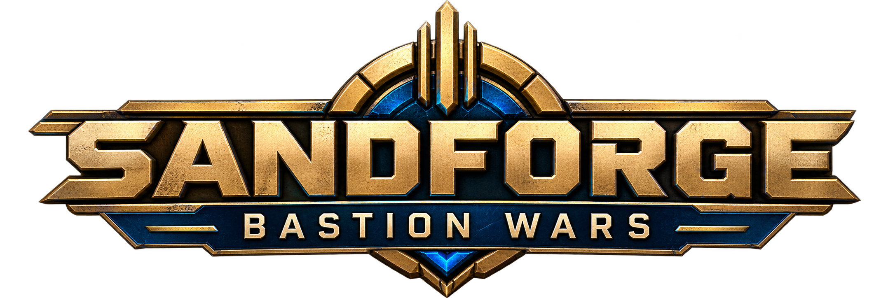
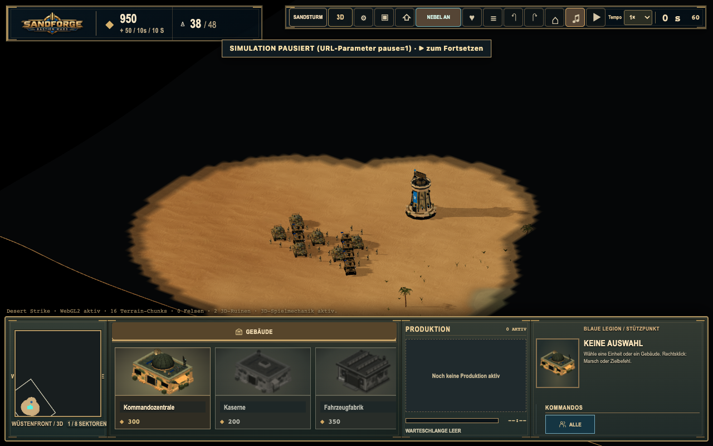

<div align="center">



# SANDFORGE: BASTION WARS

**Tactical 3D real-time strategy · Base building · AI opponents · Territorial warfare**

[Deutsch](README.md) · [Changelog](CHANGELOG.md) · [Release notes (German)](docs/releases/v1.8.0-de.md)

</div>



*Gameplay capture from the WebGL development build, November 23, 2026.*

## About

Sandforge is a desktop-browser RTS built with TypeScript and Three.js. Build a base, secure Bastions, research upgrades, and command infantry, vehicles and air support against an AI opponent.

- Twelve producible unit types, including reconnaissance drones and anti-armor infantry.
- Six maps in the game menu, terrain-based combat, fog of war, and territorial control.
- Classic and Action rulesets share the Reborn simulation.
- Local save/load, tactical pause, a horizontal HUD and 47 German radio messages.
- WebGL is the supported renderer; Classic Canvas and Atlas Dominion remain accessible archives.

## Play locally

Requires Node.js 20 or newer (CI uses Node 22).

```sh
npm ci
npm run dev
```

Open http://127.0.0.1:8095/. Alternatively run `docker compose up --build -d`.

| Control | Action |
| --- | --- |
| Left click / drag | Select units |
| Right click | Move, attack or context action |
| WASD / arrows | Move camera |
| Mouse wheel | Zoom |
| Space | Tactical pause |
| A / S | Attack move / hold position |
| F5 / F9 | Local save / load |

## Development

```sh
npm run build
npm run test:release
npm ci --prefix tests/browser
npm run test:browser
```

The 1.8.0 candidate was merged in [PR #497](https://github.com/nfekete82/sandforge/pull/497); the [post-merge CI](https://github.com/nfekete82/sandforge/actions/runs/45768425191) passed. Version tagging and GitHub release publication are separate steps.

[Release validation](RELEASE-1.8-STATUS.md) · [Architecture (historical details included)](docs/reborn/ARCHITECTURE.md) · [Third-party notices](THIRD_PARTY_NOTICES.md).

The Uberspace deployment remains disabled pending separate validation. No general project license has been selected; third-party rights are documented separately.
